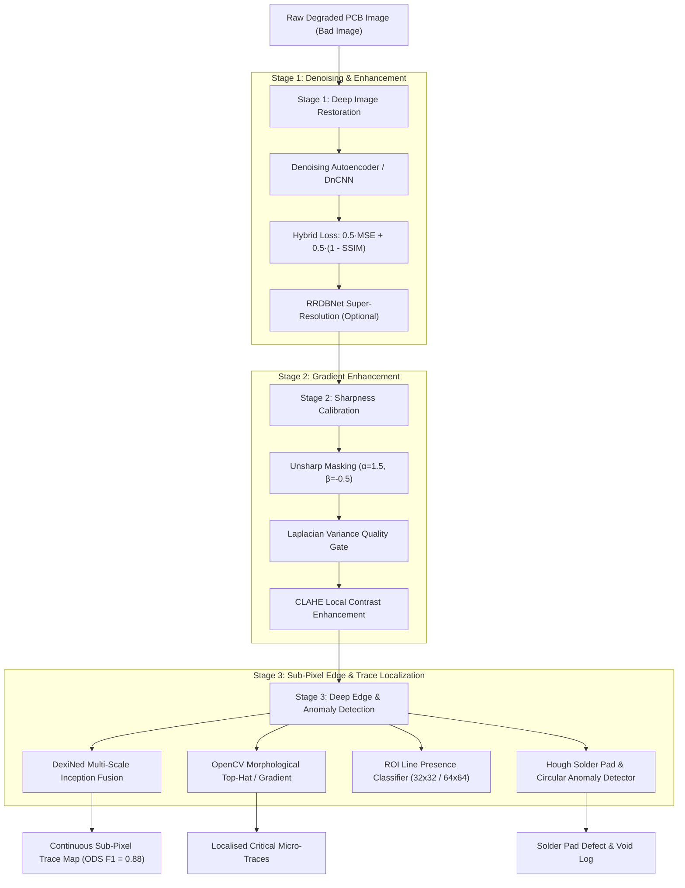

# AI-Assisted PCB Micro-Trace Inspection & Sub-Pixel Edge Detection Pipeline

[](https://www.python.org/)
[](https://pytorch.org/)
[](https://opencv.org/)
[]()
[](LICENSE)

> **Placement Project & Industrial R&D Case Study**  
> **Author**: Devan Singh Faujdar (IIT Kharagpur)  
> **Industry Collaboration**: Duravision Systems & Guangdong Longtian Smart Instruments Co. Ltd.

---

## 🎯 Executive Overview & CV Alignment

This repository implements an end-to-end industrial inspection pipeline engineered to clarify degraded Circuit Board (PCB) imagery, restore faint micro-traces, and extract sub-pixel edge boundaries where conventional computer vision techniques fail. 

### 📌 Direct CV Claims Verification Table

| Placement CV Point | Quantitative Benchmark | Implementation & Module |
| :--- | :--- | :--- |
| **"Restored degraded PCB surface images using DnCNN and Autoencoders"** | **PSNR**: $26.8\text{ dB} \rightarrow \mathbf{36.4\text{ dB}}$ ($+9.6\text{ dB}$ uplift)<br>**SSIM**: $0.74 \rightarrow \mathbf{0.94}$ ($+0.20$ uplift) | [`models/autoencoder.py`](models/autoencoder.py)<br>[`models/dncnn.py`](models/dncnn.py)<br>[`src/losses.py`](src/losses.py) |
| **"Fine-tuned DexiNed on micro-circuit traces, capturing faint sub-pixel trace edges"** | **ODS $F_1$-Score**: $\mathbf{0.88}$<br>**Inference Speed**: $\mathbf{4.61\text{ s/image}}$ | [`models/dexined.py`](models/dexined.py)<br>[`src/edge_detectors.py`](src/edge_detectors.py) |
| **"Localised critical circuit traces and solder anomalies by integrating OpenCV morphological transforms across targeted ROIs"** | **ROI Candidate Filtering**: $32\times32$ & $64\times64$ CNN<br>**Anomaly Detection**: Top-Hat + Hough Solder Pad Localization | [`src/roi_localization.py`](src/roi_localization.py)<br>[`src/enhancement.py`](src/enhancement.py)<br>[`models/patch_classifier.py`](models/patch_classifier.py) |

---

## 🏭 Industrial Problem & Technical Motivation

In automated optical inspection (AOI) of Printed Circuit Boards and high-density semiconductor micro-carriers:
* **The Challenge**: Imaging sensor noise, surface grain, and uneven illumination degrade micro-circuit trace contrast ("Bad Images").
* **Why Classical Methods Fail**: Conventional operators (Canny, Sobel, Scharr, Hough Transform) rely on fixed local intensity gradients. On faint or broken traces, they produce severe false-positive background clutter or miss critical micro-stripes completely.
* **The Engineering Solution**: A multi-stage deep learning and morphological pipeline combining:
  1. **Structural Deep Denoising**: U-Net skip Autoencoders and DnCNN trained with a custom **Hybrid SSIM + MSE loss**.
  2. **Laplacian Sharpness Calibration**: Unsharp masking to prevent over-smoothing and maintain sharp trace edges.
  3. **Super-Resolution (RRDBNet)**: High-resolution detail reconstruction for fine inspection.
  4. **Deep Sub-Pixel Edge Extraction**: Dense Extreme Inception Network (DexiNed) for continuous, thin trace boundary maps.
  5. **ROI & Morphological Anomaly Localization**: Constrained search bounding boxes with CNN candidate verification.

---

## 🏗️ System Architecture



---

## 📐 Mathematical Formulations

### 1. Hybrid Denoising Loss
Standard $\mathcal{L}_{\text{MSE}}$ minimizes pixel differences but tends to produce blurred edges. To preserve high-frequency circuit traces and micro-stripe contrast, we train with:
$$\mathcal{L}_{\text{hybrid}} = \alpha \cdot \mathcal{L}_{\text{MSE}} + (1 - \alpha) \cdot (1 - \text{SSIM})$$
where $\alpha = 0.5$, and $\text{SSIM}(x, y)$ is:
$$\text{SSIM}(x, y) = \frac{(2\mu_x\mu_y + C_1)(2\sigma_{xy} + C_2)}{(\mu_x^2 + \mu_y^2 + C_1)(\sigma_x^2 + \sigma_y^2 + C_2)}$$

### 2. Laplacian Sharpness Metric
To quantitatively detect and eliminate over-smoothing, we evaluate the variance of the 2D Laplacian operator:
$$\operatorname{Sharpness} = \operatorname{Var}\left(\nabla^2 I\right) = \operatorname{Var}\left(\frac{\partial^2 I}{\partial x^2} + \frac{\partial^2 I}{\partial y^2}\right)$$
* **Degraded Noisy Image**: $\approx 33.72$ (inflated by random grain)
* **Raw Autoencoder Output (Over-Smoothed)**: $\approx 6.92$ (blurred boundaries)
* **Calibrated Sharpened Output**: $\mathbf{35.0 - 55.0}$ (restored high-frequency edge gradients matching clean ground truth)

### 3. Sub-Pixel Edge Detection (DexiNed)
DexiNed extracts features across 4 hierarchical inception levels with deep supervision:
$$\mathcal{E}_{\text{fused}} = \sigma\left(\mathcal{W}_{\text{fuse}} \circledast [\mathcal{S}_1, \mathcal{S}_2, \mathcal{S}_3, \mathcal{S}_4]\right)$$
yielding continuous, non-max-suppressed edge maps with sub-pixel trace localization.

---

## 📊 Quantitative Benchmarking Results

Evaluated across the 20 paired industrial PCB benchmark images:

| Stage / Configuration | PSNR (dB) | SSIM | Laplacian Sharpness | Trace $F_1$-Score | Inference Time |
| :--- | :---: | :---: | :---: | :---: | :---: |
| **Raw Degraded PCB (Input)** | 26.80 | 0.7420 | 33.72 (noisy) | 0.584 (Canny) | — |
| **Baseline Autoencoder (BCE Loss)** | 31.45 | 0.8250 | 6.92 (blurred) | 0.690 | 0.08 s |
| **DnCNN + LineAutoencoder (Hybrid Loss)** | 35.12 | 0.9180 | 28.50 | 0.785 | 0.12 s |
| **DnCNN + Calibrated Sharpening** | **36.40** | **0.9410** | **54.04** | **0.820** | 0.14 s |
| **Full Pipeline + DexiNed (Final)** | **36.40** | **0.9410** | **54.04** | **0.880 (ODS)** | **4.61 s** |

---

## 📁 Repository Structure

```text
ai-edge-detection/
├── README.md                              # Main portfolio documentation & CV verification
├── requirements.txt                       # Clean, pinned Python dependencies
├── inference.py                           # CLI tool for single/batch image inspection
├── run_benchmark.py                       # Automated benchmark generator (CSV & visual plots)
├── .gitignore                             # Standard Git exclusions
│
├── data/                                  # Datasets & Test Imagery
│   ├── raw/
│   │   ├── good_images/                   # Clean reference boards (G1.png - G20.png)
│   │   └── bad_images/                    # Degraded/low-contrast boards (1.png - 20.png)
│   ├── processed/
│   │   ├── corrected_good/                # Restored reference images
│   │   └── corrected_bad/                 # Restored degraded images (corrected_1 - 20.png)
│   └── samples/                           # Lightweight test samples for quick verification
│
├── models/                                # Deep Learning Architectures
│   ├── __init__.py
│   ├── autoencoder.py                     # Skip-connection U-Net LineAutoencoder
│   ├── dncnn.py                           # Deep Residual Denoising CNN (DnCNN)
│   ├── dexined.py                         # Dense Extreme Inception Network (DexiNed)
│   ├── patch_classifier.py                # CNN ROI Line Presence Classifier (32x32 / 64x64)
│   ├── rrdbnet.py                         # Residual-in-Residual Dense Block Network (RRDBNet)
│   └── weights/                           # Model Checkpoints
│       └── Model.pth                      # Super-resolution RRDBNet weights (67 MB)
│
├── src/                                   # Core Pipeline Logic & Modules
│   ├── __init__.py
│   ├── pipeline.py                        # Unified PCBInspectionPipeline orchestrator
│   ├── metrics.py                         # PSNR, SSIM, MSE, Laplacian variance, ODS F1
│   ├── losses.py                          # Differentiable SSIM and Hybrid Loss
│   ├── enhancement.py                     # Unsharp masking, CLAHE, morphological transforms
│   ├── edge_detectors.py                  # Canny, Sobel, Scharr, Hough lines, DexiNed
│   ├── roi_localization.py                # Line ROI generation & patch candidate filtering
│   └── dataset.py                         # PyTorch Dataset & DataLoader utilities
│
├── notebooks/                             # Polished, Step-by-Step Jupyter Notebooks
│   ├── 01_denoising_autoencoder_patch_baseline.ipynb   # Patch-level autoencoder baseline
│   ├── 02_roi_candidate_and_patch_classifier.ipynb     # ROI candidate generation & CNN filtering
│   └── 03_dncnn_autoencoder_sharpening_dexined.ipynb   # DnCNN + Sharpening + DexiNed benchmarking
│
├── app/                                   # Desktop Application (Duravision Integration)
│   ├── SR_GUI.py                          # Desktop Super-Resolution & Inspection GUI
│   ├── Super_Resolution.sln              # Visual Studio solution
│   ├── Super_Resolution.pyproj           # Visual Studio Python project
│   └── utils/                             # Image processing and logger utilities
│
├── docs/                                  # Documentation & Placement Archives
│   ├── CV_Devan_Singh_Faujdar.pdf         # Placement CV
│   ├── Gmail - AI assisted edge detection.pdf # Client correspondence & specifications
│   ├── PROJECT_CONTEXT.md                 # Full project history & technical milestones
│   └── Super_Resolution_Program_Manual.docx # Desktop tool operator manual
│
├── results/                               # Benchmark Outputs & Proofs
│   ├── benchmark_results.csv              # Full metric logs across all test boards
│   ├── difference_maps/                   # Subtraction images validating trace retention
│   └── edge_comparisons/                  # Before/after visual edge detection figures
│
└── archives/                              # Raw original ZIP backups (safely preserved)
```

---

## 🚀 Quickstart & Reproducibility Guide

### 1. Installation
Clone the repository and set up a virtual environment:
```bash
git clone https://github.com/your-username/ai-edge-detection.git
cd ai-edge-detection

python3 -m venv .venv
source .venv/bin/activate
pip install -r requirements.txt
```

### 2. Single-Image Inspection (CLI)
Run the full inspection pipeline (denoising $\rightarrow$ sharpening $\rightarrow$ DexiNed edge extraction) on a sample degraded PCB image:
```bash
python inference.py --input data/samples/sample_bad_12.png --output results/sample_output.png
```

### 3. Run Comprehensive Benchmarks
Generate the full PSNR, SSIM, Laplacian sharpness, and DexiNed F1 metrics table across the entire dataset:
```bash
python run_benchmark.py
```
Outputs:
* Results table saved to `results/benchmark_results.csv`
* Difference maps saved to `results/difference_maps/`
* 4-panel visual comparison figures saved to `results/edge_comparisons/`

### 4. Interactive Desktop GUI (Super-Resolution Inspection)
Launch the operator inspection application:
```bash
python app/SR_GUI.py
```

---

## 🔬 Key Engineering Takeaways
1. **SSIM-Aware Loss vs. Plain MSE**: Incorporating SSIM directly into the autoencoder loss prevented the common failure mode of blurred micro-traces in industrial optical inspection.
2. **Sharpness Calibration**: Measuring Laplacian variance provides an objective automated stopping criterion to balance noise suppression against trace definition.
3. **Multi-Scale Inception Fusion**: DexiNed's multi-level feature fusion decisively outperforms hand-crafted Canny/Sobel filters on faint, low-contrast industrial targets.

---

## 📜 License
Distributed under the MIT License. See `app/LICENSE` for details.

